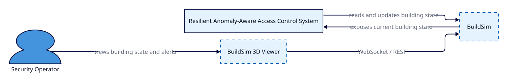
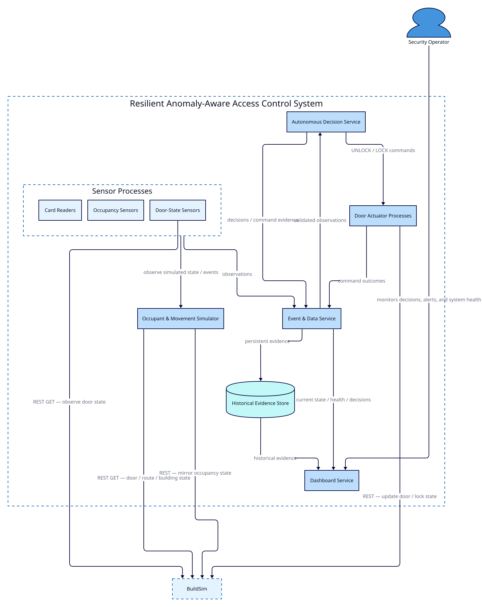

# Architecture

Version: 0.2  
Status: Frozen for implementation and evaluation

This baseline incorporates ADR-001 through ADR-006.

Further architectural changes should be limited to corrections required by implementation evidence or blocking interface problems.

## 1. Purpose and Scope

The purpose of this system is to provide resilient, anomaly-aware building access control in a simulated cyber-physical environment.

The system observes access attempts and occupancy-related sensor data, evaluates authorization and behavioral context, makes autonomous access decisions, issues commands to controlled-door actuators, and verifies the resulting physical state through BuildSim.

The architecture is designed to satisfy the course requirement for a distributed cyber-physical system with independently deployable sensor, actuator, and autonomous decision-making components.

The system is intentionally designed so that authorization, anomaly detection, decision policy, and physical actuation are distinct concerns.

The system operates entirely on the student laptop using independently restartable processes, with BuildSim providing the current shared building-state representation and 3D visualization environment.

---

## 2. System Context



The system context consists of three primary elements:

- **Security Operator** — observes building state, access decisions, anomalies, alerts, and component health.
- **Resilient Anomaly-Aware Access Control System** — the student-developed cyber-physical system responsible for sensing, decision-making, actuation, persistence, and evaluation.
- **BuildSim** — an externally supplied building simulation and visualization environment that exposes rooms, equipment, sensors, actuators, doors, routing information, and current state through APIs.

BuildSim is treated as external to the student-developed system.

The access-control system interacts with BuildSim through documented APIs but does not rely on BuildSim for historical data persistence or authorization logic.

Relevant requirements include:

- REQ-BS-001
- REQ-BS-002
- REQ-BS-003
- REQ-VIS-001

---

## 3. System Boundary

The system boundary contains all student-developed runtime components required to implement the access-control behavior.

Inside the system boundary are:

- occupant and movement simulator
- card-reader processes
- occupancy-sensor processes
- door-state-sensor processes
- event and data service
- persistent historical evidence store
- autonomous decision service
- door-actuator processes
- dashboard service

BuildSim is outside the boundary because it is provided as part of the course environment.

The Security Operator is also outside the system boundary and interacts with the system through the dashboard and BuildSim visualization.

The architecture deliberately separates independently deployable runtime components rather than implementing the project as a monolithic application.

This directly supports:

- REQ-DIST-001
- REQ-DIST-002
- REQ-DIST-003
- REQ-RES-004

---

## 4. Container Architecture



The container architecture shows the major independently running components and the principal communication paths between them.

The primary control path is:

1. The simulator generates occupant movement and access behavior.
2. Sensor processes observe relevant events.
3. Observations are transmitted to the event and data service.
4. The autonomous decision service evaluates the observations.
5. Approved decisions produce actuator commands.
6. Door-actuator processes update BuildSim door or lock state.
7. The simulator reads the updated BuildSim state before allowing subsequent movement.
8. Resulting movement produces new sensor observations.

This closes the cyber-physical feedback loop required by REQ-SIM-006 and REQ-BS-003.

A secondary evidence path stores observations, decisions, commands, and outcomes for later replay, analysis, training, and evaluation.

---

## 5. Component Responsibilities

### 5.1 Occupant and Movement Simulator

The simulator generates occupant behavior within the configured building environment.

Responsibilities include:

- generating normal weekday movement patterns
- applying configurable stochastic variation
- supporting deterministic random seeds
- generating explicit evaluation scenarios
- attempting movement across controlled boundaries
- reading current BuildSim door and route state
- preventing movement through locked controlled doors
- updating simulated occupancy following successful movement

The simulator is not responsible for authorization or access-control decisions.

Relevant requirements:

- REQ-SIM-001
- REQ-SIM-002
- REQ-SIM-003
- REQ-SIM-004
- REQ-SIM-005
- REQ-SIM-006
- REQ-TEST-001

---

### 5.2 Sensor Processes

Sensor processes represent independently running simulated physical devices.

Initial sensor types are:

- card readers
- occupancy sensors
- door-state sensors

Each sensor instance is independently deployable and restartable.

Sensor processes generate observations and publish current device state to BuildSim where appropriate.

They do not make authorization or actuator decisions.

Relevant requirements:

- REQ-DIST-001
- REQ-DATA-001
- REQ-DATA-003
- REQ-RES-003
- REQ-RES-005

---

### 5.3 Event and Data Service

The event and data service provides the primary ingestion and processing path for sensor observations.

Responsibilities include:

- accepting sensor observations
- validating message structure
- assigning or preserving event identity
- detecting duplicates
- identifying late or out-of-order observations
- preserving timestamps and quality metadata
- forwarding validated observations to decision-making components
- writing retained evidence to persistent storage
- exposing operational data for dashboard visualization

The service forms the boundary between raw device observations and validated system data.

Relevant requirements:

- REQ-DATA-001
- REQ-DATA-003
- REQ-DATA-004
- REQ-DATA-005
- REQ-DATA-006
- REQ-TEST-002

---

### 5.4 Historical Evidence Store

The historical evidence store retains system data required for replay, evaluation, analysis, and debugging.

The retained evidence includes, where applicable:

- sensor observations
- access attempts
- authorization decisions
- anomaly scores
- final access decisions
- actuator commands
- actuator outcomes
- door-state events
- occupancy events

The historical evidence store is separate from BuildSim because BuildSim represents current runtime state and does not provide the required persistent historical record.

Relevant requirements:

- REQ-DATA-002
- REQ-BS-002
- REQ-TEST-002

---

### 5.5 Autonomous Decision Service

The autonomous decision service evaluates sensor observations and determines whether an actuator action should be requested.

Internally, the service is expected to contain logically separate functions for:

- authorization
- anomaly detection
- decision policy
- runtime assurance

Authorization determines whether an action is permitted.

Anomaly detection determines whether observed behavior differs from expected behavior.

The decision policy combines these signals according to explicit rules.

Runtime assurance applies hard safety constraints before an actuator command is released.

An anomaly result does not override an authorization denial.

Relevant requirements:

- REQ-AUTH-001 through REQ-AUTH-008
- REQ-DEC-001 through REQ-DEC-007
- REQ-RES-001

---

### 5.6 Door Actuator Processes

Door-actuator processes receive validated commands from the autonomous decision service and apply physical-state changes through BuildSim.

Each controlled door has an independently running actuator process.

Responsibilities include:

- accepting actuator commands
- validating command identity and target door
- applying lock or unlock state through BuildSim
- preventing duplicate physical effects
- recording command outcome
- reporting unconfirmed or failed actuation

Relevant requirements:

- REQ-FUNC-002
- REQ-FUNC-003
- REQ-FUNC-004
- REQ-DIST-007
- REQ-RES-002
- REQ-BS-003

---

### 5.7 Dashboard Service

The dashboard provides an operator-facing view of the current and historical system state.

The dashboard shall show:

- current occupancy
- controlled-door state
- recent access decisions
- anomaly or alert state
- degraded or failed component state where applicable

The dashboard may use BuildSim's existing visualization capabilities where appropriate rather than recreating the 3D building view.

Relevant requirement:

- REQ-VIS-001

### 5.8 System Configuration

The system uses a versioned machine-readable configuration bundle for static security and topology information including users, cards, roles, permissions, security zones, controlled doors, and device bindings.

System Configuration is an architectural artifact rather than an independently deployed runtime service.

The Autonomous Decision Service, Simulator, and device processes load the subset of configuration required for their responsibilities.

The configuration identifier is retained with experiment evidence to support reproducibility.

---

## 6. Control Flow

The primary access-control sequence is:

1. The simulator establishes occupant intent, movement, and model time.
2. Sensor processes observe relevant simulated state or events.
3. A CardReader emits an access-attempt observation when a credential is
   presented at a controlled boundary.
4. The Event and Data Service validates the observation and records it.
5. The Autonomous Decision Service evaluates deterministic authorization and
   available anomaly context.
6. The Decision Policy produces ALLOW or DENY and optional alert information.
7. Runtime Assurance validates any proposed actuator action.
8. An ALLOW decision may result in an UNLOCK actuator command.
9. The DoorActuator applies the command to BuildSim.
10. Door-state observation verifies the resulting physical state.
11. The simulator observes whether the controlled boundary permits movement.
12. Successful passage updates simulator-owned occupancy truth.
13. Occupancy sensors subsequently observe the changed occupancy.
14. After passage, or after the configured no-open timeout, the Autonomous
    Decision Service issues a LOCK command.
15. Decisions, commands, actuator outcomes, and resulting observations are
    returned through the Event and Data Service for persistent evidence.

---

## 7. Data Flow

The architecture separates live control data from historical evidence.

### Live control path

```text
Sensor
  -> Event/Data Service
  -> Autonomous Decision Service
  -> Door Actuator
  -> BuildSim
```

This path is intended to remain small and low-latency.

### Evidence Path

```text
Sensor Observations
        |
        v
Event/Data Service
        |
        v
Historical Evidence Store

Autonomous Decision Service
        |
        | decisions / command evidence
        v
Event/Data Service

Door Actuator
        |
        | command outcomes
        v
Event/Data Service
```

The Event and Data Service acts as the single logical writer to the Historical
Evidence Store.

This allows an access attempt to be traced through:

```text
Observation
-> Authorization
-> Anomaly Result
-> Access Decision
-> Actuator Command
-> Actuator Outcome
-> Physical Observation
-> Occupancy Outcome
```

---

## 8. Cyber-Physical Feedback Loop

The system is designed as a closed-loop cyber-physical system rather than as a one-way decision pipeline.

The feedback loop is:

```text
simulated behavior
  -> sensor observation
  -> autonomous decision
  -> actuator command
  -> BuildSim state change
  -> simulator reads new physical state
  -> occupant movement changes
  -> new sensor observation
```

The critical property is that actuator commands influence future physical and behavioral state.

For example, if an access attempt is denied, the corresponding door remains locked and the simulator shall not move the occupant through that controlled boundary.

If access is approved and the door is successfully unlocked, the simulator may permit movement, causing occupancy state to change.

This satisfies:

- REQ-SIM-006
- REQ-BS-003

---

## 9. BuildSim Integration

BuildSim is treated as the authoritative representation of current building state.

It provides:

- building and room topology
- door state
- routing information
- equipment representation
- sensor values
- actuator state
- 3D visualization

Student-developed services interact with BuildSim through its APIs.

Important architectural constraints are:

- BuildSim does not provide the historical evidence store.
- BuildSim does not determine authorization.
- BuildSim does not perform anomaly detection.
- BuildSim does not generate the project's occupant behavior.
- BuildSim runtime state may be lost on restart.

Student-developed device processes must therefore support safe re-registration and recovery following BuildSim or component restart.

Relevant requirements:

- REQ-DIST-005
- REQ-DIST-006
- REQ-BS-001
- REQ-BS-002
- REQ-BS-003

---

## 10. Failure and Recovery Assumptions

The architecture assumes that individual distributed components may fail independently.

Expected failure conditions include:

- sensor process unavailable
- stale sensor observation
- malformed observation
- duplicated observation
- delayed or out-of-order observation
- decision service unavailable
- actuator process unavailable
- actuator command not confirmed
- BuildSim unavailable
- individual component restart

The architecture favors bounded failure behavior rather than assuming reliable communication.

Important safety rules include:

- loss of authorization capability shall not unlock a locked door
- stale data must be identifiable
- unconfirmed actuator state must be represented as unverified
- restart of one component shall not require restart of the complete system
- duplicate messages shall not produce duplicate physical effects

These behaviors support:

- REQ-DIST-004
- REQ-DIST-007
- REQ-RES-001
- REQ-RES-002
- REQ-RES-003
- REQ-RES-004
- REQ-RES-005

---

## 11. Architectural Decisions and Tradeoffs

### Distributed Processes Versus Monolith

The system uses independently running processes for sensors, actuators, and autonomous decision-making components.

This introduces network communication and partial-failure handling but enables independent restart, fault injection, isolation, and testing.

It is also required by the course architecture constraints.

### BuildSim as Current State Rather Than Historical State

BuildSim is used for current building and equipment state because this is its intended role.

Persistent evidence is stored separately so that history survives application restarts and can be replayed for evaluation.

### Authorization Separated from Anomaly Detection

Authorization answers:

> Is this action permitted?

Anomaly detection answers:

> Is this behavior unusual?

These are intentionally separate because unusual behavior may still be permitted, while normal-looking behavior may still be unauthorized.

This prevents anomaly scores from silently becoming security policy.

### One Autonomous Decision Service

Authorization, anomaly detection, decision policy, and runtime assurance are initially colocated within one autonomous decision-service process.

They are logically separated internally but are not initially deployed as separate network services.

This reduces distributed-system complexity while preserving clear responsibility boundaries.

The architecture can later evolve if independent scaling or failure testing requires additional process boundaries.

The Autonomous Decision Service also owns logical per-door control state, including pending access cycles, relock timers, command correlation, and verification status.

### Communication Technology

The logical architecture currently defines communication responsibilities but does not yet mandate a specific transport for every interface.

The implementation may use HTTP or another local messaging mechanism where justified.

The communication choice will be documented separately as an architectural decision.

---

## 12. Requirements Traceability

The architecture provides a first mapping between requirements and system components.

| Requirement Area | Primary Architectural Components |
|---|---|
| Functional access control | Decision Service, Actuator Processes, Simulator |
| Authorization | Decision Service |
| Building topology | Simulator, BuildSim |
| Simulation | Simulator |
| Autonomous decisions | Decision Service |
| Distributed execution | Sensor Processes, Decision Service, Actuator Processes |
| Data pipeline | Event/Data Service, Historical Evidence Store |
| Resilience | All distributed components |
| Visualization | Dashboard, BuildSim |
| BuildSim integration | Simulator, Sensors, Actuators |
| Performance | Event/Data Service, Decision Service |
| Evaluation | Event/Data Service, Historical Evidence Store |

Detailed requirement-to-test traceability is maintained in `test-plan.md`.

---

## 13. Architecture Status

This document represents the initial architecture baseline.

The following implementation details remain intentionally unresolved and will be defined during detailed design:

- exact transport protocol between distributed components
- persistent storage technology
- precise event schemas
- authorization precedence rules
- anomaly-detection algorithm
- freshness thresholds
- retry and timeout values
- latency acceptance threshold
- exact BuildSim door and lock API interactions

These decisions will be captured in the design specification, data contracts, and architectural decision records before implementation.